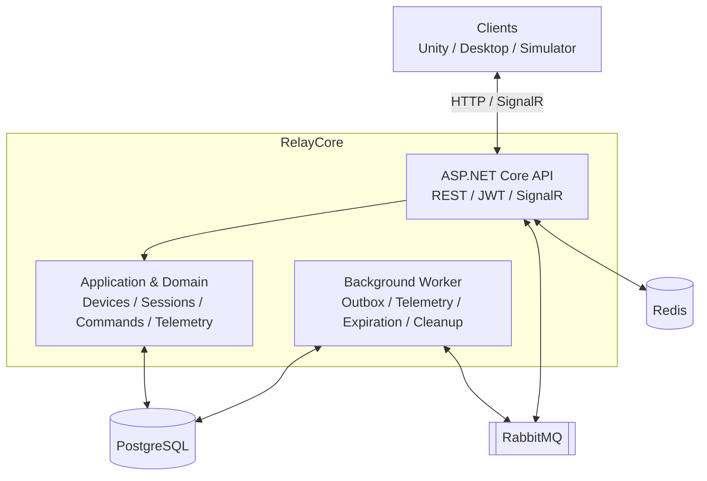
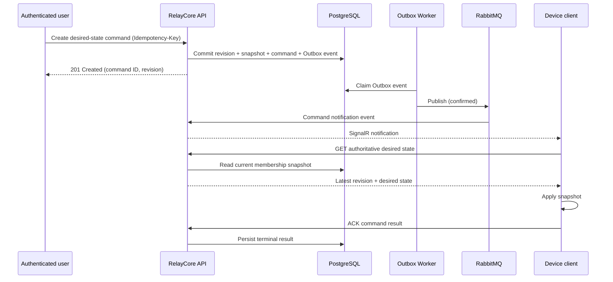

# RelayCore

**Real-time session and device orchestration with C# and .NET.**

RelayCore is an open-source backend project for managing connected applications, devices, and live sessions. It is designed around long-running clients such as Unity applications, desktop software, and simulators.

The project focuses on durable state, concurrency, idempotency, and recovery from interrupted connections—not just pushing messages in real time.

> **Status:** Under active development. The architecture and functionality below describe the intended v1 scope; individual components may not yet be implemented.

## Features

- **Identity and devices:** JWT authentication, independently authenticated devices, credential revocation, and owner-scoped authorization.
- **Session management:** Create, start, pause, resume, and complete sessions with optimistic concurrency and enforced membership constraints.
- **Device presence:** Redis-backed heartbeats with expiring online status.
- **Desired-state commands:** Persisted configuration snapshots, monotonically increasing revisions, execution acknowledgements, and protection against stale or out-of-order updates.
- **Real-time updates and recovery:** SignalR notifications with HTTP state reconciliation after disconnects, missed notifications, or client restarts.
- **Reliable messaging:** RabbitMQ, Transactional Outbox, publisher confirms, bounded retries, dead-letter queues, and idempotent consumers.
- **Telemetry:** Asynchronous ingestion, duplicate detection, one-minute aggregates, and session-level statistics.
- **Diagnostics and verification:** Structured logging, distributed tracing, integration tests, failure scenarios, and load testing.

## Tech Stack

| Area | Technology |
| --- | --- |
| Language and runtime | C# 14, .NET 10 LTS |
| HTTP API | ASP.NET Core Controllers, OpenAPI |
| Authentication | JWT Bearer, ASP.NET Core authorization policies |
| Persistence | PostgreSQL, EF Core, Npgsql, Dapper |
| Presence | Redis |
| Messaging | RabbitMQ |
| Real-time transport | ASP.NET Core SignalR |
| Background jobs | .NET `BackgroundService` |
| Observability | Serilog, OpenTelemetry, Jaeger |
| Tests | xUnit, NSubstitute, FluentAssertions, Testcontainers, NBomber |
| Infrastructure and CI | Docker Compose, GitHub Actions |

## Architecture

RelayCore uses a **modular monolith** with a separate API process and background Worker. PostgreSQL owns durable business state; Redis tracks ephemeral presence; RabbitMQ transports asynchronous messages. SignalR provides notifications, not durable delivery guarantees.



The API also hosts the RabbitMQ notification consumer because it needs access to SignalR connections. The Worker publishes Outbox messages, processes telemetry, and performs expiration and retention tasks.

### Command lifecycle



Commands contain **complete desired-state snapshots**, rather than arbitrary remote executable actions. PostgreSQL commits each new revision atomically with its command and Outbox event. Older revisions cannot overwrite a newer desired state.

**Reliability model:** Message delivery and notifications can be duplicated, delayed, or reordered. The client reconciles its state through HTTP, while execution acknowledgements are persisted separately. RelayCore does **not** claim exactly-once delivery or exactly-once client execution.

## API Overview

| Area | Representative endpoints |
| --- | --- |
| Authentication | `POST /api/auth/register`, `POST /api/auth/login`, `POST /api/device-auth/token` |
| Devices | `POST /api/devices`, `GET /api/devices`, `POST /api/devices/{id}/heartbeat` |
| Sessions | `POST /api/sessions`, `POST /api/sessions/{id}/start`, `/pause`, `/resume`, `/complete` |
| Membership | `POST /api/sessions/{id}/devices`, `DELETE /api/sessions/{id}/devices/{deviceId}` |
| Commands | `POST /api/commands`, `GET /api/commands/{id}`, `POST /api/commands/{id}/ack` |
| Recovery | `GET /api/devices/{id}/desired-state`, `GET /api/devices/{id}/commands/pending` |
| Telemetry | `POST /api/telemetry`, `GET /api/sessions/{id}/statistics` |
| Health | `GET /health/live`, `GET /health/ready` |

The API uses JWT authorization, JSON contracts, standard HTTP status codes, and `ProblemDetails` responses. OpenAPI/Swagger is part of the planned v1 interface.

## Getting Started

**Prerequisites:** Docker with Docker Compose. For local development without containerized .NET processes, use the .NET 10 SDK.

Once the Compose configuration and services are implemented, the intended clean-checkout startup command is:

```bash
docker compose up --build
```

The Compose deployment is designed to start PostgreSQL, Redis, RabbitMQ, Jaeger, a one-shot database migration service, the API, and the Worker. Local configuration will be documented in `.env.example`; no credentials or production secrets should be committed.

This is the **target quick-start workflow**, not a verified installation procedure while the project is in development.

## Client Simulator

A .NET console simulator is planned to exercise the public HTTP and SignalR interfaces without database shortcuts. It will create test devices, simulate heartbeats and telemetry, apply desired-state revisions, send ACKs, and verify reconnection and recovery behavior.

Planned invocation:

```bash
dotnet run --project tools/RelayCore.ClientSimulator -- \
  --clients 50 \
  --heartbeat-interval 10 \
  --telemetry-interval 5
```

## Testing and Performance

The planned test suite covers unit tests, integration tests against real PostgreSQL/Redis/RabbitMQ containers, and concurrency and failure-recovery scenarios.

```bash
dotnet test
```

Load tests use NBomber to measure throughput, latency percentiles, and error rates for heartbeat, telemetry, session, and command workloads. Performance results will be published only after reproducible measurements.

## Scope and Limitations

V1 targets **a single API instance, a single Worker instance, and a single logical PostgreSQL database**. It does not target multi-region deployment, horizontal scaling, high availability, or Kubernetes. Redis presence does not prove that a SignalR connection is active; SignalR notifications are best-effort. Durable recovery relies on PostgreSQL and authenticated HTTP reconciliation.

## Project Status

**In development.** The initial milestone prioritizes identity, devices, sessions, desired-state commands, HTTP recovery, concurrency correctness, and a working client simulator. The full v1 scope adds RabbitMQ/Outbox, telemetry aggregation, observability, CI, and measured performance testing.

## License

Apache License 2.0.
