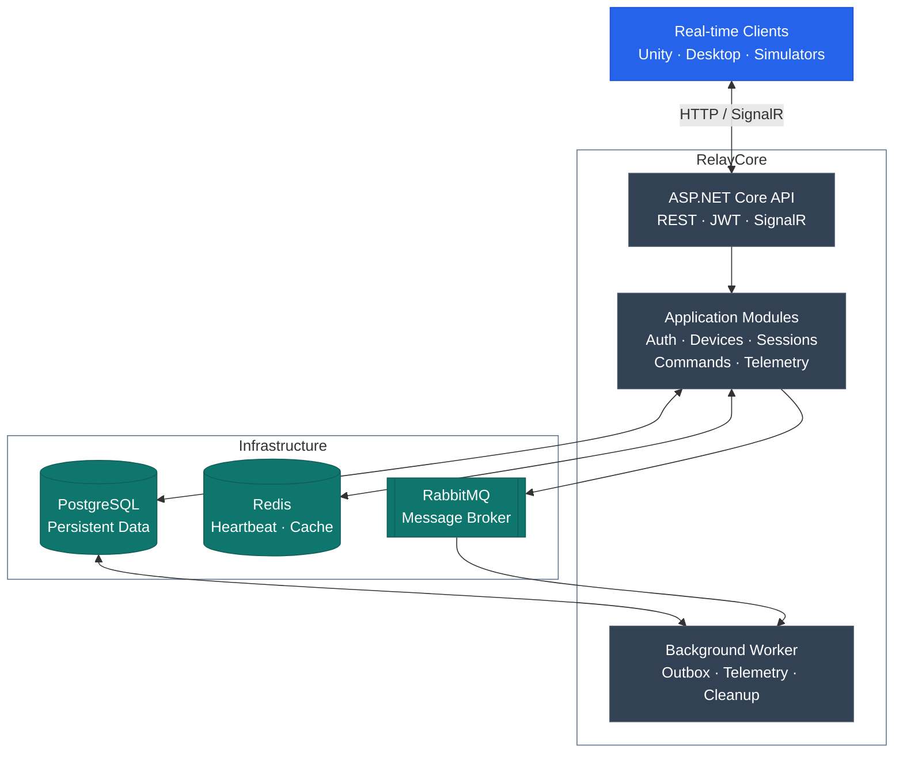

# RelayCore

**Open-source real-time session orchestration platform built with C# and .NET.**

RelayCore is a backend system for managing connected applications, devices, live sessions, remote commands, and telemetry.

Designed for Unity applications, desktop software, simulators, and other real-time clients.

## Features

- Device registration and online/offline monitoring
- Live session lifecycle management
- Real-time commands via SignalR
- Telemetry collection and aggregation
- Reliable asynchronous event processing
- JWT authentication and authorization
- Idempotency and optimistic concurrency
- Distributed tracing and structured logging

## Tech Stack

- **Backend:** C#, .NET, ASP.NET Core
- **Database:** PostgreSQL, EF Core, Dapper
- **Caching:** Redis
- **Messaging:** RabbitMQ
- **Real-time:** SignalR
- **Infrastructure:** Docker Compose
- **Testing:** xUnit, Testcontainers
- **Observability:** Serilog, OpenTelemetry, Jaeger
- **CI:** GitHub Actions

## Architecture

RelayCore uses a **modular monolith** with a dedicated background worker for asynchronous processing.

### Components

- **API:** HTTP endpoints, authentication, authorization, and real-time communication.
- **Application:** Business use cases, session management, commands, and telemetry ingestion.
- **Worker:** Outbox publishing, event consumption, telemetry aggregation, and cleanup.
- **PostgreSQL:** Persistent domain state and transactional Outbox.
- **Redis:** Ephemeral device presence and caching.
- **RabbitMQ:** Asynchronous message delivery.

The API and Worker share application and infrastructure libraries but run as separate processes.

## Project Status

Under active development.

## License

Apache License 2.0.
